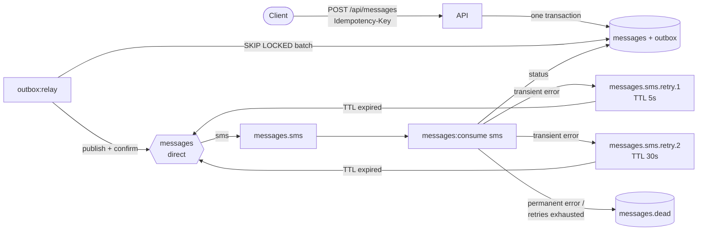

# notification-hub

[](https://github.com/bygagashek/notification-hub/actions/workflows/ci.yml)

A message delivery service built with Laravel 12 and RabbitMQ. A client posts an SMS, email or Telegram message. The service stores it, sends it to the provider in the background, retries on transient errors with growing delays, and dead-letters it when retries run out.

The goal is reliable delivery when any piece can fail: the API process, the broker, a consumer, or the provider.

- A message accepted by the API is never lost.
- A message is never sent twice, even when RabbitMQ delivers it twice.
- A retry storm cannot block the queue for other messages.

The providers here are stubs that write to the log (`LogSender`). Everything around them is real, and the tests run against real RabbitMQ and MariaDB.

## Architecture



The email and telegram channels have the same set of queues.

## Design decisions

**Transactional outbox.** The API writes the message and an `outbox` row in one database transaction. It never talks to RabbitMQ directly. If the broker is down, the API keeps accepting messages. If the process dies between the commit and the publish, nothing is lost.

**Publisher confirms.** `outbox:relay` takes a batch of rows with `FOR UPDATE SKIP LOCKED` and publishes it. It waits for the broker's acks and only then marks the rows as published. Messages are published with `mandatory`, so an unroutable message comes back as `basic.return` instead of disappearing. A nack, a return or a timeout rolls the batch back, and the relay publishes it again. Several relay instances can run at the same time; `SKIP LOCKED` keeps them on different rows.

**Idempotent API.** Every request carries an `Idempotency-Key` header.

- Same key, same body: the original message is returned with `200`.
- Same key, different body: `409 Conflict`.
- Two requests racing with the same key: the unique index decides the winner, and the loser replays the winner's result.

**Idempotent consumer.** Delivery is at-least-once, so the consumer must tolerate duplicates. Each queued payload is `{message_id, attempt}`. The consumer locks the message row and calls the provider only if the stored attempt counter equals `attempt - 1`. A redelivered or stale copy is acked as a duplicate. The provider is called once per attempt.

**Retries through TTL queues, one queue per step.** A failed attempt is published to `messages.<channel>.retry.<N>`. That queue has a fixed TTL and no consumers. When the TTL expires, the message dead-letters back into the main exchange.

Each step has its own queue because RabbitMQ only expires messages at the head of a queue. With one retry queue and per-message TTLs, a 120-second message at the head would hold back the 5-second ones behind it. Fixed TTL per queue avoids this, and it needs no delayed-message plugin.

The delays come from `MESSAGING_RETRY_DELAYS` (default `5,30,120`, so at most four attempts).

**Failure classes.**

- `TransientFailure` (timeout, provider 5xx): the message is retried.
- `PermanentFailure` (invalid recipient): the message goes straight to `messages.dead`.
- Malformed payload: the delivery is nacked without requeue, and the queue dead-letters it.
- Database or broker error inside the consumer: the delivery is requeued and the worker backs off. The attempt counter is updated in the same transaction, so the redelivery is accepted.

**Quorum queues, persistent messages, manual acks, prefetch.** The broker can lose a node without losing messages. A consumer holds at most `CONSUMER_PREFETCH` unacked deliveries.

**Two AMQP channels per process.** Confirms are awaited on a separate publishing channel, never on the channel that is delivering to the consumer callback.

## API

```http
POST /api/messages
Idempotency-Key: order-1842-reminder
Content-Type: application/json

{"channel": "sms", "recipient": "+375291234567", "body": "Your table is booked for 19:00"}
```

```http
HTTP/1.1 202 Accepted

{"data": {"id": "01JB3...", "channel": "sms", "recipient": "+375291234567",
          "status": "pending", "attempts": 0, "last_error": null, "sent_at": null, ...}}
```

`GET /api/messages/{id}` returns the current status: `pending`, `retrying`, `sent` or `failed`.

Recipient validation depends on the channel:

| Channel | Recipient format |
|---|---|
| `sms` | E.164 phone number |
| `email` | email address |
| `telegram` | chat id |

The demo sender reacts to two markers in the body:

- `[flaky]` fails the first two attempts, so the message goes through both retry queues;
- `[reject]` fails permanently.

## Running

```bash
docker compose up --build
```

This starts:

- MariaDB and RabbitMQ (management UI at http://localhost:15672, `guest`/`guest`);
- a one-shot `setup` container that runs migrations and declares the topology;
- the API on http://localhost:8000;
- the relay;
- one consumer per channel.

```bash
curl -X POST localhost:8000/api/messages \
  -H 'Content-Type: application/json' -H 'Idempotency-Key: demo-1' \
  -d '{"channel":"sms","recipient":"+375291234567","body":"[flaky] hello"}'

docker compose logs -f consumer-sms   # retried, retried, sent
```

Console commands:

| Command | Purpose |
|---|---|
| `php artisan amqp:setup` | Declare exchanges and queues. Idempotent. |
| `php artisan outbox:relay [--once]` | Publish pending outbox rows. |
| `php artisan messages:consume {channel} [--max-messages=N] [--idle-timeout=S]` | Run a consumer. It stops cleanly on SIGTERM. |

## Tests

```bash
composer install
vendor/bin/phpunit --testsuite Unit,Feature   # sqlite in memory, in-memory broker
vendor/bin/phpstan analyse                    # level 8, Larastan
```

The Feature tests cover:

- the API contract: 202, idempotent replay, 409, 400, 422, 404;
- the relay: ordering, batches, unconfirmed batches staying pending;
- every branch of the delivery handler, including a broker failure in the middle of a retry.

The Integration suite needs RabbitMQ on `RABBITMQ_HOST`, and is skipped without it. It runs the whole path through a real broker:

- normal delivery;
- the retry queues;
- the dead-letter queue;
- a duplicate delivery.

CI runs three jobs:

- Unit and Feature tests on PHP 8.3 and 8.4, plus PHPStan;
- the Integration suite against RabbitMQ and MariaDB service containers;
- a smoke test of the full `docker compose` stack.

## Layout

```
app/Http/          controller, request validation, resource
app/Messaging/     outbox relay, delivery handler, broker abstraction, AMQP topology
app/Channels/      sender interface, failure types, demo LogSender
app/Console/       amqp:setup, outbox:relay, messages:consume
tests/Support/     InMemoryBroker, ScriptedSender
```

## License

MIT
